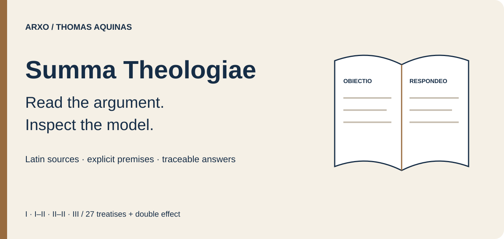
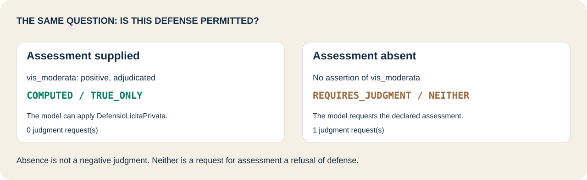
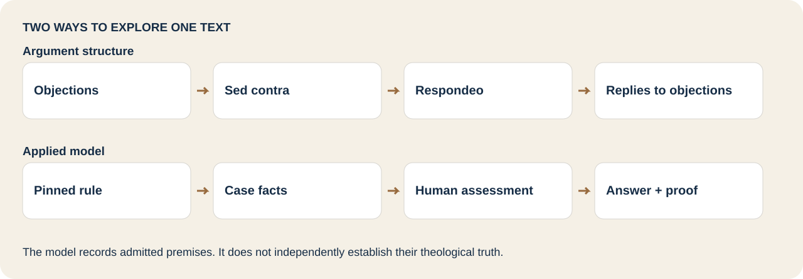
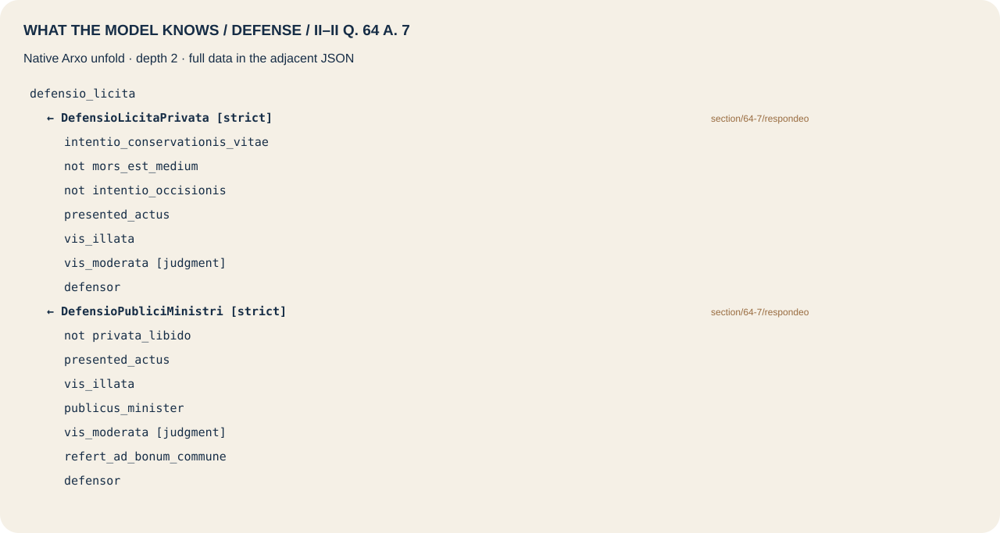
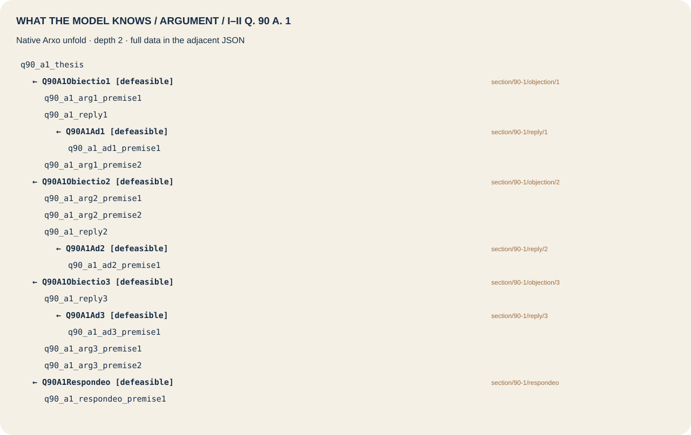

# Arxo Summa Theologiae

Explore Thomas Aquinas’s **Summa Theologiae** through pinned Latin sources, visible argument structures and executable case questions. Start with the **Treatise on Law** or **double effect**, then browse the 27 treatises of I–III.

This is a research model of the text and selected applications. **An executable article is not a complete formalization of its philosophical reasoning.** The engine derives consequences of the model’s admitted premises; it does not independently establish their theological truth.

[Run a question](#run-a-question) · [Law and arguments](#law-and-arguments) · [Argument reconstructions](#argument-reconstructions) · [Explore the cases](#explore-the-cases) · [Browse the family](#browse-the-family-and-depth) · [Inspect evidence](#inspect-evidence) · [Reproduce](#reproduce-the-checks)

## Run a question

Requirements: **Node.js 20+** and Git; **macOS arm64** or **Linux x86_64**. Install the standard CLI through npm. Models are delivered by this repository; there is no Summa model npm package.

```sh
npm install -g @arxo/cli@0.2.4
git clone https://github.com/arxohq/arxo-summa-theologiae.git
cd arxo-summa-theologiae
law eval examples/traveller-defense
```

A traveller faces an attack, intends to preserve life, and supplies an **adjudicated** assessment of proportionate force. Death is explicitly neither intended nor a means. The answer to `defensio_licita` is **`COMPUTED / TRUE_ONLY`**, under the selected *respondeo* of II–II q. 64 a. 7.

Remove only the supplied assessment by choosing the existing companion case:

```sh
law eval examples/defense-awaits-judgment
```

Now the answer is **`REQUIRES_JUDGMENT / NEITHER`**. The model names the missing assessment and its declared authority. It does not replace that judgment with a numerical force threshold.



Each [example directory](examples) contains `request.json`, the full canonical case and query, and the recorded canonical answer. `law eval` runs it directly. Python is only used by optional maintainer verification.

## Law and arguments

The **Treatise on Law**, `la.aquinas.summa_theologiae_law@0.1.0`, covers I–II qq. 90–97. Begin with the four jointly necessary conditions in q. 90 a. 4:

```sh
law eval examples/law-definition
```

The [complete input](examples/law-definition/case.json) supplies an ordinance of reason, direction to the common good, a community caretaker as issuer, and promulgation. `is_law` returns `TRUE_ONLY`; the exact definition also emits its necessity constraint as `SATISFIED`. The complete document retains both results.

Browse the [.law definition](packages/law/02-definitio-legis.law), [natural law example](examples/natural-law), and [q. 90 a. 1 argument example](examples/law-argument).



The argument layer addresses **objections, sed contra, respondeo and replies**. In the supplied graph, *sed contra* is an admitted leaf and is not attackable. Replies undermine the corresponding objection’s modeled point. The article’s Latin proof text remains available through source fragments; its complete internal reasoning is not independently proved by the engine.

The applied layer uses selected *respondeo* conclusions. Some guards are deliberately simple: in the [God-exists example](examples/theological-head-applies), the rule is activated by `presented` and `question_of_existence`. This demonstrates the [declared application rule](packages/i-de-deo/02-applied.law), **not an automated reconstruction of the Five Ways**. The [companion input](examples/theological-head-not-established) lacks the second guard and yields `NEITHER`, not an explicit negative theological conclusion.

## Argument reconstructions

**New in v0.2.0:** seven independent experimental models reconstruct selected internal transitions, with explicit premises and intermediate conclusions. Begin with II–II q.64 a.7:

```sh
law eval reconstruction/examples/intended-death-objection
law eval reconstruction/examples/incidental-death-reply
```

The first native argumentation answer is `SKEPTICALLY_ACCEPTED`. In the companion input, explicitly unintended death supplies the reply and the objection is `REJECTED`. An unknown intention does not supply that negative fact.

```sh
law eval reconstruction/examples/defense-awaits-judgment
law eval reconstruction/examples/conflicting-proportionality
law eval reconstruction/examples/first-mover-not-established
```

These retain, respectively, `REQUIRES_JUDGMENT / NEITHER`, conflicting proportionality as `BOTH`, and an unestablished first mover as `NEITHER`. A finite actualization witness is not a proof of a first mover or of all Five Ways.

| Reconstruction | Scenarios | Checked finite fragments | Conditional | Source reconstruction only | Unsupported in this profile |
|---|---:|---:|---:|---:|---:|
| [II–II q.64 a.7](reconstruction/articles/ii-ii-q64-a7) | 24 | 5 | 5 | 7 | 0 |
| [I q.1 a.8](reconstruction/articles/i-q1-a8) | 7 | 3 | 4 | 6 | 1 |
| [I–II q.90 a.1](reconstruction/articles/i-ii-q90-a1) | 7 | 1 | 5 | 4 | 0 |
| [I–II q.90 a.2](reconstruction/articles/i-ii-q90-a2) | 8 | 0 | 5 | 4 | 0 |
| [I–II q.90 a.3](reconstruction/articles/i-ii-q90-a3) | 8 | 3 | 1 | 4 | 0 |
| [I–II q.90 a.4](reconstruction/articles/i-ii-q90-a4) | 10 | 5 | 1 | 4 | 2 |
| [I q.2 a.3 · control](reconstruction/articles/i-q2-a3) | 9 | 4 | 1 | 3 | 12 |
| **Total** | **73** | **21** | **22** | **32** | **15** |

The status columns classify **90 project-defined fragments and obligations**; they are not the article denominator used below. All **56 source sections** are mapped; **zero whole articles are fully verified**. Checked finite fragments retain their admitted source principles. Conditional bridges, external judgments, authority acceptance and unsupported universal or modal obligations stay visible even when a scenario passes.

[Read the reconstruction contract and limits](reconstruction) · [Choose among 13 native examples](reconstruction/examples) · [Inspect all seven model identities](reconstruction/models.json) · [Recorded authoring acceptance](reconstruction/reports/acceptance.json)

## Explore the cases

The six original [.lawcase inputs](cases/moral-cases/cases) supply 15 retained moral questions. Their expected outcomes come from the existing example kit; fresh CLI checks are recorded separately.

| Start with | What changes | Recorded answer |
|---|---|---|
| [Traveller defense](examples/traveller-defense) | Positive adjudication of proportionate force | `COMPUTED / TRUE_ONLY` |
| [Awaiting assessment](examples/defense-awaits-judgment) | Assessment absent | `REQUIRES_JUDGMENT / NEITHER` |
| [Excessive defense](examples/excessive-defense) | Negative adjudication of proportionate force | `COMPUTED / TRUE_ONLY` for `defensio_illicita` |
| [Why defense is not established](examples/why-defense-is-not-established) | Inspect blockers for permitted defense | `COMPUTED / NEITHER`, with blockers |
| [Public authority](examples/public-authority-defense) | Apply the model’s public-minister exception | `COMPUTED / TRUE_ONLY` |
| [Just war](examples/just-war) | Authority, just cause and right intention supplied | `COMPUTED / TRUE_ONLY` |
| [Wrong intention](examples/war-with-wrong-intention) | Supplied intention defeats the just-war model | `COMPUTED / TRUE_ONLY` for `bellum_illicitum` |
| [Normative positions](examples/traveller-positions) | Inspect instantiated permissions and prohibitions | Native position document, including statuses |

You can also ask the original authored case with the native CLI:

```sh
law ask cases/moral-cases --case ViatorContraLatronem \
  --query-json cases/moral-cases/queries/viator-defensio-licita.json \
  --out runs/traveller
law eval runs/traveller
```

`TRUE_ONLY`, `FALSE_ONLY`, `BOTH` and `NEITHER` distinguish positive support, negative support, conflict and absence. Evaluation status is separate. Preserve negative facts and `origin adjudicated`; neither absence nor conflict should be simplified to a Boolean.

Double effect is a distinct applied package, `la.aquinas.duplex_effectus@0.1.0`. Its two source articles overlap the charity and justice treatises; do not add them to the family’s 2669-article denominator. The treatise graph and the applied double-effect package do not replace one another.

## Browse the family and depth

All 28 model specs and world identities are in [models.json](models.json). The 27 treatises cover **512 questions and 2669 author-numbered articles** in I–III. **Supplementum is outside this release.** Package versions remain **0.1.0**, semantics **`law.core/0.2.11`**. Models are independent, without package imports; the moral case kit explicitly binds its one dependency.

| Model | Source range | Structurally EXECUTABLE / articles | Recorded v0.1.0 scenarios passed |
|---|---|---:|---:|
| [Sacred doctrine](packages/i-sacra-doctrina) | I · qq. 1–1 | 10 / 10 | 6 |
| [God](packages/i-de-deo) | I · qq. 2–26 | 149 / 149 | 8 |
| [Trinity](packages/i-de-trinitate) | I · qq. 27–43 | 74 / 74 | 6 |
| [Creation](packages/i-de-creatione) | I · qq. 44–49 | 27 / 27 | 6 |
| [Angels](packages/i-de-angelis) | I · qq. 50–64 | 72 / 72 | 6 |
| [Six days](packages/i-de-sex-diebus) | I · qq. 65–74 | 29 / 29 | 6 |
| [Human nature](packages/i-de-homine) | I · qq. 75–102 | 138 / 138 | 8 |
| [Divine governance](packages/i-de-gubernatione) | I · qq. 103–119 | 85 / 85 | 6 |
| [Final end](packages/i-ii-fine) | I-II · qq. 1–5 | 40 / 40 | 12 |
| [Human acts](packages/i-ii-actibus) | I-II · qq. 6–21 | 94 / 94 | 10 |
| [Passions](packages/i-ii-passionibus) | I-II · qq. 22–48 | 132 / 132 | 10 |
| [Habits and virtues](packages/i-ii-habitibus) | I-II · qq. 49–70 | 105 / 105 | 10 |
| [Vices and sins](packages/i-ii-vitiis) | I-II · qq. 71–89 | 108 / 108 | 10 |
| [Treatise on law](packages/law) | I-II · qq. 90–97 | 38 / 38 | 53 |
| [Old and New Law](packages/old-new-law) | I-II · qq. 98–108 | 58 / 58 | 12 |
| [Grace](packages/i-ii-gratia) | I-II · qq. 109–114 | 44 / 44 | 16 |
| [Faith](packages/ii-ii-fide) | II-II · qq. 1–16 | 81 / 81 | 8 |
| [Hope](packages/ii-ii-spe) | II-II · qq. 17–22 | 34 / 34 | 8 |
| [Charity](packages/ii-ii-caritate) | II-II · qq. 23–46 | 142 / 142 | 10 |
| [Prudence](packages/ii-ii-prudentia) | II-II · qq. 47–56 | 56 / 56 | 6 |
| [Justice](packages/ii-ii-iustitia) | II-II · qq. 57–122 | 303 / 303 | 10 |
| [Fortitude](packages/ii-ii-fortitudine) | II-II · qq. 123–140 | 66 / 66 | 8 |
| [Temperance](packages/ii-ii-temperantia) | II-II · qq. 141–170 | 129 / 129 | 8 |
| [Gifts and states of life](packages/ii-ii-gratiis) | II-II · qq. 171–189 | 106 / 106 | 8 |
| [Incarnation](packages/iii-incarnatione) | III · qq. 1–26 | 151 / 151 | 6 |
| [Life of Christ](packages/iii-vita-christi) | III · qq. 27–59 | 174 / 174 | 8 |
| [Sacraments](packages/iii-sacramentis) | III · qq. 60–90 | 224 / 224 | 12 |
| [Double effect](packages/duplex-effectus) | II–II q. 64 a. 7; q. 40 a. 1 | 2 / 2 | 17 |

The [per-unit depth report](reports/formalization-depth.json) uses the existing `boundaries.depth` classifier on each model’s **own nodes**, with its pinned `named_section` division declaration. The units are author-numbered *articuli*. Duplicate source witnesses are excluded from a package denominator. The report retains source, declaration, model and implementation hashes, individual unit rows, and unmeasured dimensions.

**EXECUTABLE means a deriving rule references that article.** It measures structural executability, not the completeness of every premise or philosophical inference within the article. Graph rules and guarded application heads contribute to that measure. Unpinned translations, independent theological validity and *Supplementum* are not measured. No claim of “100% formalized” follows from the table.

The earlier corpus inventory and audits are historical evidence. The v0.1.0 verification records **294 scenarios over these 28 packages** and **20 reader examples**. The v0.2.0 delivery checks the seven new reconstructions and replays the original reader examples; it does not rerun those unchanged 294 scenarios. The full corpus is `not_checked`; overall acceptance remains `releaseVerified: false`.

## Inspect evidence

```sh
law inspect examples/traveller-defense/result.json summary
law inspect examples/law-argument/result.json summary
```

The saved documents contain canonical hashes, proof graphs, instantiated positions and judgment requests. Source anchors live on the actual rule and fragment nodes in the proof/model; a top-level `sourceAnchors` array may be empty. Read the original `.law` and pinned Latin alongside the machine result.

<details>
<summary>Native unfold: permitted defense</summary>



[Native unfold JSON](assets/unfold-defense.json). This shows possible derivations; the case proof records the derivations actually used.

</details>

<details>
<summary>Native unfold: q. 90 a. 1 argument</summary>



[Native unfold JSON](assets/unfold-argument.json). The accepted leaf and modeled objection structure are explicit premises of this graph.

</details>

To regenerate either tree (advanced interface):

```sh
law engine unfold registry/la-aquinas-duplex_effectus.lawir.json \
  defensio_licita --clir registry --depth 2 --lang la --json
```

## Reproduce the checks

```sh
law test packages/duplex-effectus
law test packages/law
```

These execute only the selected packages. The manual [addressed CI](.github/workflows/verify.yml) defaults to the seven reconstructions, repeated native evaluation, 13 new examples, original reader example replay and exact archive inventory. Select `reader` or `all-addressed` explicitly to rerun the 28 original packages. It does not discover the full corpus. Optional maintainer entry: `python3.12 tools/check.py --examples-only`; reconstruction maintainer instructions are [here](reconstruction/tools).

[Verification](reports/verification.json) · [Source pin](source-pin.json) · [Runtime pin](toolchain.lock.json) · [Publication inventory](CANON-MANIFEST.json) · [Delivery and limits](docs/DELIVERY.md)

## Sources, interpretation and license

Pinned Latin sources retain the edition labels and publication addresses recorded by each model. The electronic transmission is [Corpus Thomisticum](https://www.corpusthomisticum.org/iopera.html); the model marks it `PINNED_UNOFFICIAL_COPY`. Edition labels vary by source and are not replaced by one date for the whole Summa. English navigation and Russian glosses are unofficial; this delivery does not contain a separately pinned English translation.

The model is **doctrine**, not an enactment by a contemporary legislature or a decision about a real dispute. The engine does not supply missing factual assessments or certify a theological interpretation. Existing source notices are retained in [NOTICE](NOTICE) and [family/NOTICE](family/NOTICE). Models and consumer code are Apache-2.0; publisher text provenance remains separately identified. Arxo is not affiliated with Corpus Thomisticum or the Leonine Commission.
