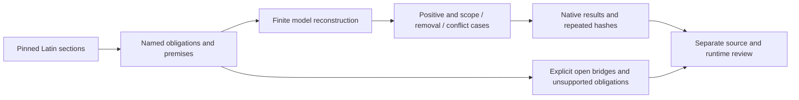

# Summa: argument reconstruction on the existing runtime

Seven experimental article packages make the distinction between a source
argument, an executable finite reconstruction, and an open proof obligation
inspectable. They are delivered in the [Summa reader](https://github.com/arxohq/arxo-summa-theologiae)
as an additive experimental layer in v0.2.0. The original 28 models and registry
retain their versions and bytes.

The work began with II–II q.64 a.7, continued through I q.1 a.8 and I–II q.90
a.1–4, and used I q.2 a.3 as a contrasting control. The seven articles and the
control criterion were fixed before implementation. All **56 source sections**
are mapped. This is source inventory, not a percentage of proved arguments.

## Run a question

From the repository root, with Node.js 20+ on macOS arm64 or Linux x64:

```sh
npm install -g @arxo/cli@0.2.4
law eval reconstruction/examples/intended-death-objection
law eval reconstruction/examples/incidental-death-reply
law inspect reconstruction/examples/incidental-death-reply/result.json summary
```

The broad objection is `SKEPTICALLY_ACCEPTED` with an intended death, and
`REJECTED` with the explicit non-intention reply. These are native argumentation
answers. The [13 example directories](examples) retain full inputs and canonical
results, including judgment, conflict, conditional bridge and control cases.

## Read the result

| Article | Scenarios | Checked finite fragments | Conditional | Reconstructed only | Unsupported proof obligations |
|---|---:|---:|---:|---:|---:|
| [II–II q.64 a.7](articles/ii-ii-q64-a7/README.md) | 24 | 5 | 5 | 7 | 0 |
| [I q.1 a.8](articles/i-q1-a8/README.md) | 7 | 3 | 4 | 6 | 1 |
| [I–II q.90 a.1](articles/i-ii-q90-a1/README.md) | 7 | 1 | 5 | 4 | 0 |
| [I–II q.90 a.2](articles/i-ii-q90-a2/README.md) | 8 | 0 | 5 | 4 | 0 |
| [I–II q.90 a.3](articles/i-ii-q90-a3/README.md) | 8 | 3 | 1 | 4 | 0 |
| [I–II q.90 a.4](articles/i-ii-q90-a4/README.md) | 10 | 5 | 1 | 4 | 2 |
| [I q.2 a.3](articles/i-q2-a3/README.md) | 9 | 4 | 1 | 3 | 12 |
| **Total** | **73** | **21** | **22** | **32** | **15** |

The last four columns classify **90 project-defined obligations/fragments**.
They are not canonical divisions of the text and do not replace the existing
`boundaries.depth` structural measure. No whole article is marked fully
verified. See each `reconstruction.json`, the [contract](CONTRACT.md), and the
[machine report](reports/acceptance.json) for statements, source sections,
premise kinds, dependencies, tested symbols, and verification scope.

`VERIFIED_IN_PROFILE` means the stated implemented finite fragment was reviewed
against the source and checked using the fixed runtime and current fixtures.
It does not certify the truth of its philosophical premises or the entire
engine. `CONDITIONAL` retains explicit bridges, authority acceptance, lexical
interpretation, or external practical judgment. `RECONSTRUCTED` records source
reasoning whose complete transition is not established. `UNSUPPORTED` names a
stronger proof obligation the selected profile does not check; it does not mean
that Aquinas has been refuted. No obligation is labelled `INVALID_IN_PROFILE`.

## What changed in the reconstruction

- Self-defense separates intended killing, intended self-preservation, and an
  incidental death. A native defeasible objection branch is defeated by the
  explicit non-intention reply; unknown intention does not supply that reply.
- Permission requires an actual self-defense context. Proportionality remains
  an external judgment with `adjudicated` provenance, including on the public
  authority route. Absence gives `REQUIRES_JUDGMENT`; conflicting findings give
  `BOTH`, while the conservative dependent conclusions stay `NEITHER`.
- Clerical irregularity is represented separately from moral culpability.
- The q.90 common-happiness chain exposes its reconstructed bridge. A
  conclusion-shaped common-happiness premise was removed. Remote transmission
  and future writing require an actual promulgation; four-condition aggregation
  is separate from proving promulgation's general necessity.
- The control checks target-state and same-aspect actualization, actual identity
  comparison, finite causal paths, and repeated observations. A self-cause input
  conflicts with a declared irreflexive-order principle, producing native
  `BOTH`; it does not discharge a proof that the cause input is false.



## Reproduce an article

The selected tool is the published **`@arxo/cli@0.2.4`**, executing
`law.core/0.2.11`. Install the CLI through npm:

```sh
npm install -g @arxo/cli@0.2.4
law version --json
```

The public [runtime lock](../toolchain.lock.json) pins both the **Darwin arm64**
and **Linux x64** native executables. The runner measures the actual executable
before invoking it, and checks its reported version and binary hash. Historical
Darwin authoring evidence remains separately pinned in `source-pin.json`; it is
not the public execution allowlist.

For a global npm installation, the installed launcher's own locator supplies
that path:

```sh
LAW_RECON_BIN="$(node --input-type=module -e '
  const { locateBinary } = await import(process.argv[1]);
  const found = locateBinary();
  if (found.error) throw new Error(found.error);
  console.log(found.binary);
' "$(npm root -g)/@arxo/cli/bin/law.js")"
```

From this directory:

```sh
python3 tools/verify.py \
  --article ii-ii-q64-a7 \
  --law-bin "$LAW_RECON_BIN" \
  --out /tmp/arxo-summa-q64-evidence
```

Replace `--article` with `--all-selected` to check only these seven packages.
The output directory must be outside this public repository. The runner compiles
the article models, executes the declared scenarios, evaluates every query step
twice, retains native documents, checks repeated result/document hashes, and
rejects protected conclusions asserted in package or case inputs.
It does not implement a second subject evaluator or change ledger statuses.

## Boundaries of this result

Baseline inference, `law.argumentation/0.2` acceptance, and formal checker
certificates are separate claims. The first Way's identity guard works in
baseline; guards are outside argumentation v1. No certificate from Lean or the
engine checker was run. The runtime's proof nodes do not provide native source
anchor certificates for these runs: provenance is supplied by pinned excerpts,
model annotations, and the project section mapping. Native `outcomeHash` is
unavailable and is not counted as a matching hash.

The Five Ways are inventoried separately. Finite witnesses do not establish
universal regress termination, temporal modal transitions, qualitative
maximality, or a universal intelligent director. Separate accepted-premise
contexts do not implement hypothesis discharge. An open required obligation
blocks full article acceptance; independent fragments can still be checked.

The corpus's runtime lockset is unpublished and no runtime is installed from
that lockset. This explicit published-CLI selection is therefore recorded as
`UNPINNED_FROM_CORPUS_LOCKSET`, even though its native bytes are independently
pinned. The four complete source input files were also checked against the
captured reader snapshot; the portable runner checks the local excerpts.

The [authoring acceptance report](reports/acceptance.json) preserves its original
local-stage `published: false` and Darwin evidence. Public delivery is recorded
separately in [public-verification.json](reports/public-verification.json), the
[release workflow](../.github/workflows/verify.yml) and the release assets.
Overall acceptance remains `releaseVerified: false`; full corpus `not_checked`.
No engine source, original canon model, model npm package or public catalogue
was changed.
Fixture dates are synthetic audit contexts, not claims about legal effect or
the historical date of Aquinas's argument.
